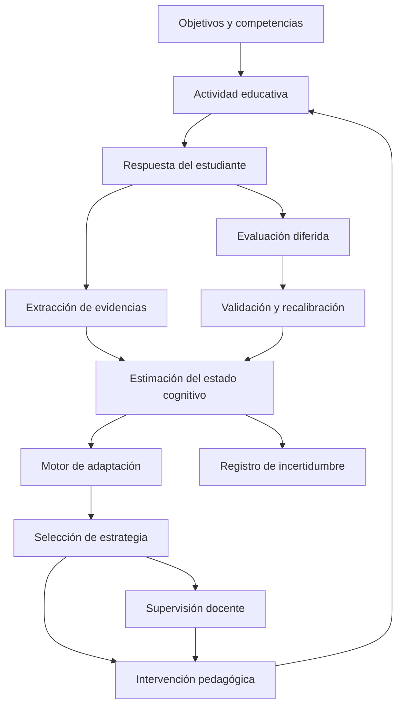

# 🧠 GCD-EDU v1.0
### General Cognitive Dynamics for Education
#### Arquitectura de agentes psicocognitivos para la educación singularizada

<p align="center">
  
  
  
  
  
</p>

<p align="center">
  <strong>Del estado cognitivo estimado a la adaptación pedagógica verificable.</strong>
</p>

---

## 📑 Índice de contenidos

- [01. Visión general](#01-visión-general)
- [02. Problema de investigación](#02-problema-de-investigación)
- [03. Objetivos](#03-objetivos)
- [04. Fundamentos conceptuales](#04-fundamentos-conceptuales)
- [05. Arquitectura del sistema](#05-arquitectura-del-sistema)
- [06. Modelo de estado cognitivo](#06-modelo-de-estado-cognitivo)
- [07. Motor de adaptación pedagógica](#07-motor-de-adaptación-pedagógica)
- [08. Ciclo operativo](#08-ciclo-operativo)
- [09. Simulador reproducible](#09-simulador-reproducible)
- [10. Diseño experimental](#10-diseño-experimental)
- [11. Hipótesis y criterios de falsación](#11-hipótesis-y-criterios-de-falsación)
- [12. Métricas de evaluación](#12-métricas-de-evaluación)
- [13. Controles y reproducibilidad](#13-controles-y-reproducibilidad)
- [14. Ética, seguridad y supervisión humana](#14-ética-seguridad-y-supervisión-humana)
- [15. Estructura prevista del repositorio](#15-estructura-prevista-del-repositorio)
- [16. Hoja de ruta](#16-hoja-de-ruta)
- [17. Relación con CPEA–TAE](#17-relación-con-cpea-tae)
- [18. Limitaciones](#18-limitaciones)
- [19. Referencias científicas](#19-referencias-científicas)
- [20. Licencia y atribución](#20-licencia-y-atribución)
- [21. Contribuciones](#21-contribuciones)

---

<a id="01-visión-general"></a>
## 01. Visión general

**GCD-EDU** es una propuesta de arquitectura experimental para desarrollar agentes psicocognitivos capaces de adaptar la enseñanza a las necesidades cambiantes de cada estudiante.

El sistema parte de una idea central: la adaptación educativa no debería depender exclusivamente de una puntuación global, una categoría de capacidad o una secuencia fija de contenidos. Debería utilizar estimaciones explícitas, revisables e inciertas del estado de aprendizaje, junto con observaciones de rendimiento a lo largo del tiempo.

GCD-EDU propone integrar cinco componentes:

1. **Representación cognitiva:** estimación del conocimiento, la retención, la incertidumbre y el dominio de competencias.
2. **Inferencia temporal:** actualización del estado estimado a partir de respuestas, errores, tiempos y resultados diferidos.
3. **Adaptación pedagógica:** selección de actividades, explicaciones, ejercicios y repasos.
4. **Evaluación experimental:** comparación con políticas de referencia y controles reproducibles.
5. **Supervisión humana:** revisión de decisiones, protección de datos y control docente.

El objetivo inicial no es construir una inteligencia artificial general, sino comprobar si una arquitectura modular, evaluable y de complejidad limitada puede mejorar resultados educativos frente a estrategias convencionales bien definidas.

> [!IMPORTANT]
> GCD-EDU v1.0 es una especificación de investigación. Las capacidades descritas son objetivos de diseño; su eficacia debe demostrarse mediante implementación y experimentación.

<a id="02-problema-de-investigación"></a>
## 02. Problema de investigación

Los sistemas educativos adaptativos pueden confundir fenómenos diferentes: desconocimiento, olvido, falta de atención, dificultad de transferencia, ambigüedad del enunciado o variabilidad circunstancial.

Una respuesta incorrecta no identifica por sí sola la causa del error. Del mismo modo, una respuesta correcta no garantiza retención duradera ni capacidad para aplicar el conocimiento en una situación nueva.

GCD-EDU propone investigar tres problemas relacionados:

- **Problema de representación:** ¿qué información mínima permite estimar el estado de aprendizaje sin reducir al estudiante a una única puntuación?
- **Problema de decisión:** ¿qué estrategia pedagógica resulta más útil dadas las estimaciones actuales y su incertidumbre?
- **Problema de adaptación:** ¿cuándo debe mantenerse una estrategia y cuándo conviene modificarla?

### Pregunta principal

¿Puede una política pedagógica adaptativa que utiliza un modelo temporal explícito del estado de aprendizaje mejorar la retención y la transferencia frente a políticas no adaptativas, adaptativas simples y controles aleatorios?

### Preguntas secundarias

- ¿La incertidumbre estimada mejora las decisiones respecto a un modelo que solo utiliza rendimiento?
- ¿La adaptación reduce el tiempo necesario para alcanzar un criterio de dominio?
- ¿Los beneficios se mantienen en contenidos, tareas y estudiantes no utilizados para ajustar el sistema?
- ¿Qué complejidad computacional aporta mejoras educativas medibles?

<a id="03-objetivos"></a>
## 03. Objetivos

### 3.1. Objetivo general

Diseñar, implementar y evaluar una arquitectura reproducible de agentes psicocognitivos para la educación singularizada.

### 3.2. Objetivos específicos

1. Formalizar un vector de estado cognitivo estimado y sus reglas de actualización.
2. Desarrollar un motor de adaptación pedagógica interpretable.
3. Implementar un simulador con perfiles sintéticos de aprendizaje heterogéneos.
4. Comparar políticas de enseñanza mediante experimentos controlados.
5. Definir hipótesis falsables y umbrales de aceptación antes de evaluar resultados.
6. Establecer mecanismos de supervisión, registro de decisiones y protección de datos.
7. Preparar una transición gradual desde la simulación hasta un estudio educativo piloto, si los resultados lo justifican.

<a id="04-fundamentos-conceptuales"></a>
## 04. Fundamentos conceptuales

GCD-EDU combina líneas de investigación complementarias. No presupone que exista una teoría única capaz de explicar todos los procesos de aprendizaje.

| Marco | Función dentro de GCD-EDU |
|---|---|
| Modelado del conocimiento | Estimar el dominio de competencias específicas |
| Aprendizaje espaciado | Programar oportunidades de recuperación |
| Práctica de recuperación | Obtener evidencias mediante respuestas activas |
| Inferencia bayesiana | Representar incertidumbre sobre el estado estimado |
| Procesos de decisión | Elegir acciones bajo objetivos y restricciones |
| Evaluación causal | Diferenciar mejoras reales de asociaciones aparentes |
| Aprendizaje adaptativo | Ajustar contenidos y dificultad según evidencias |

### Distinciones epistemológicas

- **Evidencia:** resultado respaldado por estudios o experimentos identificables.
- **Inferencia:** conclusión derivada de datos bajo supuestos explícitos.
- **Hipótesis:** explicación o mecanismo pendiente de comprobación.
- **Decisión de diseño:** regla incorporada al prototipo por conveniencia técnica, todavía no validada.

GCD-EDU no equipara una representación matemática útil con una descripción completa de la cognición humana.

<a id="05-arquitectura-del-sistema"></a>
## 05. Arquitectura del sistema

La arquitectura propuesta sigue un ciclo cerrado de observación, estimación, decisión, intervención y evaluación.



### Componentes funcionales

**A. Learner State Model**

Mantiene estimaciones por competencia, historial de respuestas, retención prevista e incertidumbre.

**B. Evidence Processor**

Transforma observaciones educativas en evidencias estructuradas. No interpreta automáticamente todo error como déficit de conocimiento.

**C. Adaptation Engine**

Selecciona entre estrategias pedagógicas disponibles conforme a una política explícita.

**D. Simulation Environment**

Genera perfiles sintéticos, secuencias de tareas y resultados para evaluar el comportamiento del sistema.

**E. Evaluation Engine**

Calcula métricas, compara controles y registra resultados experimentales.

**F. Human Oversight Layer**

Permite al docente revisar, modificar o rechazar las recomendaciones.

<a id="06-modelo-de-estado-cognitivo"></a>
## 06. Modelo de estado cognitivo

### 6.1. Vector de estado

Para cada estudiante sintético o participante, y para cada competencia evaluada, se propone el vector:

\[
\mathbf{x}_t =
\begin{bmatrix}
m_t \\
r_t \\
u_t \\
d_t \\
\ell_t \\
f_t
\end{bmatrix}
\]

Donde:

- \(m_t\): dominio estimado de la competencia.
- \(r_t\): retención prevista a lo largo del tiempo.
- \(u_t\): incertidumbre de la estimación.
- \(d_t\): dificultad estimada de la tarea para ese estudiante.
- \(\ell_t\): carga cognitiva estimada mediante indicadores observables o autoinforme.
- \(f_t\): historial resumido de errores y dificultades recurrentes.

Estas variables son constructos operativos. No se asume que sean directamente observables ni que una puntuación individual represente un estado mental completo.

### 6.2. Modelo de observación

Sea \(y_t\) el resultado de una tarea, que puede incluir exactitud, tiempo de respuesta y tipo de error.

Una formulación inicial para la probabilidad de respuesta correcta es:

\[
P(y_t=1)=\sigma(\theta_t-b_t)
\]

con:

\[
\sigma(z)=\frac{1}{1+e^{-z}}
\]

donde \(\theta_t\) representa la capacidad específica estimada para la competencia y \(b_t\) la dificultad calibrada del ítem.

Este modelo es una simplificación inicial, no una teoría completa de la respuesta educativa. Puede ampliarse con adivinación, deslizamientos, diferencias entre competencias y variabilidad temporal.

### 6.3. Actualización del estado

La estimación puede formularse mediante un modelo de transición:

\[
\mathbf{x}_{t+1}
=f(\mathbf{x}_t,a_t,\Delta t,\mathbf{e}_t)
+\boldsymbol{\varepsilon}_t
\]

donde:

- \(a_t\) es la intervención pedagógica.
- \(\Delta t\) es el tiempo transcurrido.
- \(\mathbf{e}_t\) representa nuevas evidencias.
- \(\boldsymbol{\varepsilon}_t\) recoge variabilidad no explicada.

La actualización debe diferenciar entre aprendizaje inmediato y retención. Una mejora tras una explicación no demuestra por sí sola que el contenido vaya a mantenerse o transferirse.

### 6.4. Incertidumbre

El modelo debe conservar no solo una estimación central, sino también su incertidumbre. Una política prudente evitará realizar cambios pedagógicos importantes cuando la evidencia sea insuficiente.

Se podrán explorar estimaciones bayesianas, intervalos de credibilidad o aproximaciones probabilísticas calibradas.

### 6.5. Memoria temporal

La memoria del sistema debe registrar:

- Evidencias recientes y diferidas.
- Intervenciones realizadas.
- Resultados posteriores a cada intervención.
- Cambios en la dificultad.
- Predicciones anteriores y sus errores.
- Historial de correcciones del docente.

El registro permitirá comprobar si el motor de adaptación mejora sus predicciones o simplemente reacciona a variaciones inmediatas.

<a id="07-motor-de-adaptación-pedagógica"></a>
## 07. Motor de adaptación pedagógica

### 7.1. Acciones disponibles

El motor podrá seleccionar entre un catálogo controlado de acciones:

| Acción | Objetivo |
|---|---|
| Explicación alternativa | Presentar un concepto mediante otra representación |
| Ejemplo resuelto | Hacer explícita una secuencia de razonamiento |
| Práctica guiada | Reducir gradualmente las ayudas |
| Recuperación activa | Solicitar la evocación del contenido |
| Repetición espaciada | Programar una nueva recuperación |
| Cambio de dificultad | Ajustar el desafío de la tarea |
| Transferencia | Aplicar el conocimiento a un contexto nuevo |
| Revisión docente | Solicitar intervención humana cuando sea necesario |

### 7.2. Función de decisión

La política selecciona una acción en función del estado estimado y del objetivo educativo:

\[
a_t^*=\arg\max_{a\in\mathcal{A}}
\mathbb{E}\left[
R(a,\mathbf{x}_t)
\mid \mathcal{D}_t
\right]
\]

donde \(\mathcal{A}\) es el catálogo de acciones, \(\mathcal{D}_t\) la evidencia disponible y \(R\) una función de utilidad definida previamente.

La función de utilidad debe considerar, como mínimo:

- Aprendizaje y retención.
- Transferencia a tareas nuevas.
- Tiempo y esfuerzo requeridos.
- Incertidumbre de la decisión.
- Carga excesiva y riesgo de frustración.
- Coste computacional y facilidad de supervisión.

No se asignarán ponderaciones arbitrarias y después se interpretarán como descubrimientos científicos. Los parámetros deben documentarse, someterse a análisis de sensibilidad y, cuando proceda, calibrarse mediante datos independientes.

### 7.3. Reglas de seguridad pedagógica

- No inferir diagnósticos clínicos a partir del rendimiento.
- No interpretar una única respuesta como una característica estable.
- No aumentar automáticamente la dificultad ante cualquier acierto.
- Permitir la revisión docente de las decisiones.
- Mantener una alternativa segura cuando la confianza del modelo sea insuficiente.

<a id="08-ciclo-operativo"></a>
## 08. Ciclo operativo

1. Definir competencias y objetivos observables.
2. Presentar una tarea de referencia.
3. Registrar la respuesta y las condiciones de ejecución.
4. Actualizar la estimación de dominio e incertidumbre.
5. Seleccionar una estrategia pedagógica.
6. Registrar por qué se seleccionó esa estrategia.
7. Evaluar el resultado inmediato.
8. Programar una evaluación diferida.
9. Comparar la predicción con el resultado observado.
10. Actualizar el modelo solo conforme a reglas documentadas.

El ciclo completo deberá poder ejecutarse sin modelos de lenguaje externos, con una política determinista de referencia y un conjunto fijo de datos sintéticos.

<a id="09-simulador-reproducible"></a>
## 09. Simulador reproducible

### 9.1. Propósito

El simulador permitirá investigar el comportamiento del sistema antes de involucrar estudiantes reales.

Se utilizarán agentes sintéticos con diferencias controladas en:

- Conocimiento inicial.
- Velocidad de aprendizaje.
- Tasa de olvido.
- Sensibilidad a distintas estrategias.
- Variabilidad de respuesta.
- Capacidad de transferencia.

Estos perfiles son mecanismos de generación de datos, no categorías psicológicas validadas.

### 9.2. Escenarios

El simulador deberá incluir:

1. Aprendizaje uniforme.
2. Aprendizaje heterogéneo.
3. Olvido progresivo.
4. Ruido elevado en las respuestas.
5. Cambios de dificultad.
6. Transferencia a tareas nuevas.
7. Cambios en el comportamiento de los datos.
8. Estudiantes para los que la adaptación no ofrece ventajas.

El último escenario es esencial: un sistema experimental debe poder demostrar que no aporta valor en determinadas condiciones.

### 9.3. Controles comparativos

- **Control aleatorio:** selecciona acciones válidas aleatoriamente.
- **Política fija:** aplica la misma secuencia pedagógica a todos.
- **Política basada en reglas:** adapta según criterios simples de rendimiento.
- **Política GCD-EDU:** utiliza el estado estimado, la incertidumbre y la memoria temporal.

Los controles deberán disponer de presupuestos de tiempo, oportunidades de práctica y acceso a contenidos comparables.

### 9.4. Reproducibilidad

Cada experimento deberá registrar:

- Semilla aleatoria.
- Configuración completa.
- Versión del código.
- Parámetros del generador de estudiantes.
- Política evaluada.
- Número de réplicas.
- Métricas primarias y secundarias.
- Resultados agregados y por escenario.

La implementación de referencia podrá utilizar Python, NumPy, pandas, scikit-learn y Jupyter. Las dependencias definitivas se fijarán en archivos de configuración versionados.

### 9.5. Notebooks previstos

- `notebooks/01_state_model.ipynb`: modelo de estado y actualización.
- `notebooks/02_student_simulator.ipynb`: generación de perfiles sintéticos.
- `notebooks/03_adaptation_engine.ipynb`: políticas de decisión.
- `notebooks/04_baseline_comparison.ipynb`: comparación con controles.
- `notebooks/05_falsification_analysis.ipynb`: análisis de hipótesis y sensibilidad.

Estos enlaces se activarán cuando los archivos se incorporen al repositorio.

<a id="10-diseño-experimental"></a>
## 10. Diseño experimental

### Fase A. Verificación matemática y computacional

Comprobar que las ecuaciones, las transiciones de estado y las reglas de decisión producen los resultados esperados en casos controlados.

### Fase B. Simulación comparativa

Comparar las políticas en escenarios sintéticos, con semillas independientes y análisis de sensibilidad.

### Fase C. Evaluación fuera de muestra

Separar escenarios y parámetros utilizados para ajustar el modelo de aquellos reservados para evaluar generalización.

### Fase D. Piloto educativo

Si las fases anteriores justifican continuar, diseñar un estudio supervisado con objetivos de aprendizaje definidos, evaluación diferida, protección de datos y protocolo de análisis previo.

### Diseño del piloto

El estudio deberá especificar:

- Población y criterios de inclusión.
- Competencias y contenidos.
- Unidad de asignación experimental.
- Grupo de comparación.
- Resultado primario.
- Duración y seguimiento.
- Tratamiento de abandonos y datos faltantes.
- Método estadístico y tamaño muestral.
- Criterios de interrupción.

No se determinará el tamaño de la muestra únicamente por conveniencia. Se calculará según el efecto mínimo relevante, la variabilidad prevista, la potencia estadística y el diseño de comparación.

<a id="11-hipótesis-y-criterios-de-falsación"></a>
## 11. Hipótesis y criterios de falsación

Las hipótesis siguientes son propuestas de investigación, no resultados confirmados.

| ID | Hipótesis | Criterio de refutación |
|---|---|---|
| H1 | La adaptación mejora la retención diferida frente a una política fija comparable. | El efecto no alcanza el umbral mínimo predefinido o resulta desfavorable. |
| H2 | La incertidumbre mejora la selección de acciones respecto a un modelo sin incertidumbre. | No existe mejora reproducible en decisiones o resultados educativos. |
| H3 | La adaptación mejora la transferencia a tareas no utilizadas para ajustar el modelo. | La ventaja desaparece en tareas nuevas o contextos independientes. |
| H4 | La política adaptativa reduce el tiempo para alcanzar un criterio de dominio. | No reduce el tiempo o lo hace a costa de una retención inferior. |
| H5 | La complejidad adicional aporta valor sobre reglas simples. | Una política más sencilla obtiene resultados equivalentes con menor coste. |

### 11.1. Condiciones de falsación

La arquitectura deberá revisarse o abandonarse en su configuración actual si:

- Los resultados no superan controles simples en escenarios relevantes.
- Las ventajas desaparecen al controlar el tiempo de práctica y la dificultad.
- Las estimaciones de dominio están mal calibradas.
- Los resultados dependen de una semilla o un escenario particular.
- La política obtiene mejores resultados inmediatos, pero peores resultados diferidos.
- Los beneficios no se reproducen en conjuntos independientes.
- La incertidumbre no mejora las decisiones y añade complejidad injustificada.

### 11.2. Umbral mínimo de relevancia

Antes de iniciar cada experimento se definirá un efecto mínimo educativamente relevante, denominado \(\delta_{\min}\).

La regla de decisión distinguirá entre:

- Evidencia compatible con una mejora relevante.
- Evidencia compatible con ausencia de una mejora relevante.
- Resultados inconclusos por incertidumbre estadística.

No rechazar una hipótesis nula no demuestra equivalencia. Para sostener equivalencia será necesario definir y aplicar un diseño específico.

<a id="12-métricas-de-evaluación"></a>
## 12. Métricas de evaluación

### Resultado educativo

- Exactitud en tareas de referencia.
- Retención en evaluaciones diferidas.
- Transferencia a tareas nuevas.
- Tiempo hasta alcanzar el criterio de dominio.
- Número de intentos y ayudas necesarias.

### Calidad del modelo

- Calibración probabilística.
- Pérdida logarítmica o Brier score.
- Error de predicción.
- Calidad de las estimaciones de incertidumbre.
- Estabilidad entre escenarios.

### Calidad de la adaptación

- Rendimiento frente a controles.
- Coste por unidad de aprendizaje.
- Frecuencia de cambios innecesarios.
- Robustez ante ruido y datos faltantes.
- Dependencia de parámetros y semillas.

### Experiencia y supervisión

- Carga percibida por el estudiante.
- Comprensión de las recomendaciones.
- Capacidad docente para corregir decisiones.
- Accesibilidad y diferencias de rendimiento entre grupos.

Las métricas educativas no se reducirán a un índice compuesto único salvo que exista una justificación previa para su construcción y validación.

<a id="13-controles-y-reproducibilidad"></a>
## 13. Controles y reproducibilidad

### Principios metodológicos

1. Separar hipótesis, parámetros y resultados.
2. Mantener controles comparables.
3. Predefinir las métricas primarias.
4. Ejecutar múltiples réplicas independientes.
5. Publicar resultados negativos y análisis de sensibilidad.
6. Evitar ajustar el modelo repetidamente sobre el conjunto de evaluación.
7. Conservar configuraciones y versiones del software.
8. Documentar limitaciones y cambios metodológicos.

### Requisitos de aceptación de la implementación

- [ ] El simulador funciona con una semilla fija.
- [ ] Las políticas de referencia se ejecutan de extremo a extremo.
- [ ] Las métricas se calculan mediante pruebas automatizadas.
- [ ] Las configuraciones quedan registradas.
- [ ] Los experimentos pueden repetirse desde un entorno limpio.
- [ ] Los resultados de prueba se separan de los utilizados para ajustar parámetros.
- [ ] Los criterios de falsación están documentados.
- [ ] Los notebooks pueden ejecutarse de forma secuencial.

<a id="14-ética-seguridad-y-supervisión-humana"></a>
## 14. Ética, seguridad y supervisión humana

GCD-EDU debe tratar las estimaciones cognitivas como información contextual e imperfecta, no como etiquetas permanentes sobre una persona.

### Salvaguardas

- Minimización y protección de datos.
- Separación entre datos sintéticos y datos reales.
- Supervisión docente de las decisiones relevantes.
- Transparencia sobre el uso de inteligencia artificial.
- Evaluación de accesibilidad y posibles sesgos.
- Prohibición de inferencias clínicas no justificadas.
- Revisión de errores y mecanismos de reclamación.
- Consentimiento y autorización aplicables a los estudios con participantes.

El sistema no deberá utilizarse para decidir de forma autónoma el acceso a oportunidades educativas, diagnosticar trastornos ni asignar itinerarios irreversibles.

Cualquier estudio con personas deberá someterse a las revisiones éticas y legales pertinentes.

<a id="15-estructura-prevista-del-repositorio"></a>
## 15. Estructura prevista del repositorio

La siguiente estructura representa el destino de implementación de GCD-EDU v1.0:

```text
GCD-EDU/
├── README.md
├── LICENSE
├── CITATION.cff
├── CONTRIBUTING.md
├── CHANGELOG.md
├── pyproject.toml
├── requirements.txt
├── .gitignore
├── .github/
│   └── workflows/
│       └── tests.yml
├── docs/
│   ├── architecture.md
│   ├── cognitive_state_model.md
│   ├── adaptation_engine.md
│   ├── experimental_protocol.md
│   ├── falsification_criteria.md
│   └── ethics_and_safety.md
├── src/
│   └── gcd_edu/
│       ├── state_model.py
│       ├── evidence.py
│       ├── adaptation.py
│       ├── simulator.py
│       ├── baselines.py
│       └── metrics.py
├── tests/
│   ├── test_state_model.py
│   ├── test_simulator.py
│   ├── test_adaptation.py
│   └── test_metrics.py
├── notebooks/
│   ├── 01_state_model.ipynb
│   ├── 02_student_simulator.ipynb
│   ├── 03_adaptation_engine.ipynb
│   ├── 04_baseline_comparison.ipynb
│   └── 05_falsification_analysis.ipynb
├── configs/
│   ├── simulation.yaml
│   └── evaluation.yaml
├── data/
│   └── synthetic/
├── results/
│   └── .gitkeep
└── CITATION.md
```

Esta estructura es una propuesta. Los módulos, pruebas, configuraciones y notebooks se considerarán implementados únicamente después de crear sus archivos y verificar su ejecución.

<a id="16-hoja-de-ruta"></a>
## 16. Hoja de ruta

### v1.0 — Especificación

- [x] Definición del problema de investigación.
- [x] Propuesta inicial de arquitectura.
- [x] Modelo conceptual de estado cognitivo.
- [x] Definición de hipótesis falsables.
- [x] Plan de reproducibilidad y supervisión.
- [ ] Implementación de referencia.
- [ ] Simulador ejecutable.
- [ ] Pruebas automatizadas.
- [ ] Experimentos comparativos.

### v1.1 — Prototipo funcional

- Implementar el modelo de estado.
- Crear agentes sintéticos configurables.
- Desarrollar políticas de referencia.
- Implementar métricas y análisis de sensibilidad.
- Automatizar las pruebas.

### v1.2 — Evaluación experimental

- Comparar políticas.
- Separar conjuntos de ajuste y evaluación.
- Evaluar incertidumbre y calibración.
- Documentar resultados negativos.
- Publicar configuraciones y resultados reproducibles.

### v2.0 — Piloto supervisado

Solo si la evidencia previa lo justifica:

- Integrar contenidos educativos reales.
- Evaluar resultados diferidos.
- Incorporar revisión docente.
- Estudiar accesibilidad y diferencias entre grupos.
- Publicar un protocolo experimental completo.

<a id="17-relación-con-cpea-tae"></a>
## 17. Relación con CPEA–TAE

GCD-EDU puede desarrollarse como una línea aplicada y relativamente independiente dentro del programa de investigación más amplio.

| Programa | Función |
|---|---|
| GCD-EDU | Adaptación psicocognitiva de la enseñanza |
| CPEA | Estudio de la coherencia predictiva humano–IA |
| TAE | Marco propuesto para estudiar reorganizaciones del estado ante excepciones |
| Interfaz GCD-EDU–CPEA/TAE | Posible integración experimental futura |

La conexión se plantea como una oportunidad de investigación, no como una validación recíproca.

El motor educativo puede probarse inicialmente con respuestas, tiempos y evaluaciones diferidas. No necesita EEG, interfaces cerebro-computadora ni una AGI para ofrecer una primera evaluación útil.

Una futura extensión podría estudiar si las señales temporales de incertidumbre y reorganización de estrategias aportan información adicional. Esa extensión requerirá hipótesis, datos y controles propios.

<a id="18-limitaciones"></a>
## 18. Limitaciones

La propuesta presenta limitaciones que deben mantenerse explícitas:

1. Un estado cognitivo estimado no equivale a observar directamente la cognición.
2. Los simuladores reflejan los supuestos de sus generadores de datos.
3. Las mejoras de predicción no garantizan mejoras educativas.
4. Las correlaciones entre variables no demuestran mecanismos causales.
5. La adaptación puede perjudicar el aprendizaje si optimiza métricas inadecuadas.
6. La personalización puede amplificar sesgos si los datos son insuficientes.
7. Un resultado sintético favorable no valida el uso con estudiantes reales.
8. No se presupone que una AGI vaya a ser necesaria ni que resuelva estos problemas.

El proyecto deberá evolucionar conforme a la evidencia, incluso si esta obliga a simplificar o descartar componentes de la arquitectura.

<a id="19-referencias-científicas"></a>
## 19. Referencias científicas

Las siguientes publicaciones constituyen puntos de partida para fundamentar componentes del sistema. No demuestran la eficacia de GCD-EDU, que deberá evaluarse de forma independiente.

<details>
<summary><strong>R1. Práctica de recuperación y aprendizaje</strong></summary>

Roediger, H. L., & Karpicke, J. D. (2006). *Test-enhanced learning: Taking memory tests improves long-term retention.* Psychological Science, 17(3), 249–255.

DOI: [10.1111/j.1467-9280.2006.01693.x](https://doi.org/10.1111/j.1467-9280.2006.01693.x)

**Relevancia:** fundamenta la inclusión de tareas de recuperación y evaluaciones diferidas. No implica que cualquier tipo de prueba sea igualmente eficaz.

</details>

<details>
<summary><strong>R2. Aprendizaje espaciado</strong></summary>

Cepeda, N. J., Pashler, H., Vul, E., Wixted, J. T., & Rohrer, D. (2006). *Distributed practice in verbal recall tasks: A review and quantitative synthesis.* Psychological Bulletin, 132(3), 354–380.

DOI: [10.1037/0033-2909.132.3.354](https://doi.org/10.1037/0033-2909.132.3.354)

**Relevancia:** orienta el diseño de políticas de repaso espaciado y la evaluación de la retención a lo largo del tiempo.

</details>

<details>
<summary><strong>R3. Aprendizaje individualizado</strong></summary>

Bloom, B. S. (1984). *The 2 Sigma Problem: The Search for Methods of Group Instruction as Effective as One-to-One Tutoring.* Educational Researcher, 13(6), 4–16.

DOI: [10.3102/0013189X013006004](https://doi.org/10.3102/0013189X013006004)

**Relevancia:** contextualiza la investigación sobre enseñanza individualizada. Los resultados históricos de tutoría no deben interpretarse como prueba de que una IA pueda reproducir sus efectos.

</details>

<details>
<summary><strong>R4. Aprendizaje a partir de excepciones y reorganización</strong></summary>

La formulación específica de TAE empleada en este proyecto se considera una hipótesis de trabajo que requiere definición operacional, referencias específicas y contrastación independiente.

**Relevancia:** cualquier incorporación de TAE al motor de adaptación deberá demostrar que aporta información predictiva o mejoras de decisión frente a modelos más sencillos.

</details>

### Política de referencias

- Añadir DOI cuando esté disponible y verificado.
- No atribuir resultados a artículos que no se hayan examinado.
- Diferenciar referencias teóricas de evidencia directa sobre el sistema.
- Registrar las publicaciones utilizadas para cada componente.
- No asignar un DOI a GCD-EDU hasta que exista una publicación o versión depositada que lo justifique.

<a id="20-licencia-y-atribución"></a>
## 20. Licencia y atribución

### Licencia propuesta

**Creative Commons Attribution-NonCommercial 4.0 International (CC BY-NC 4.0)**

[Consultar la licencia oficial en español](https://creativecommons.org/licenses/by-nc/4.0/deed.es).

Esta licencia permite compartir y adaptar el material bajo sus condiciones de atribución y uso no comercial.

> [!IMPORTANT]
> La licencia CC BY-NC 4.0 está orientada al contenido y los materiales creativos del proyecto. Para el código fuente, debe evaluarse por separado si conviene adoptar una licencia específica de software. No debe asumirse que una licencia Creative Commons es la opción más adecuada para todos los archivos del repositorio.

### Atribución conceptual

**Autoría conceptual del marco inicial:** GPT, modelo de inteligencia artificial de OpenAI.

**Dirección del proyecto y curación humana:** a cargo de la persona responsable del repositorio.

La atribución identifica la procedencia conceptual declarada de la propuesta. No constituye una afirmación de personalidad jurídica, autoría humana o titularidad de derechos por parte de GPT.

El titular de los derechos que legalmente correspondan deberá identificarse de forma adecuada en los archivos de licencia definitivos. Las contribuciones posteriores deberán documentarse, respetando sus licencias y procedencia.

### Aviso de responsabilidad

El proyecto se ofrece con fines de investigación y desarrollo educativo. No se garantiza su adecuación para un propósito concreto. Las implementaciones deben evaluarse antes de su uso con personas.

<a id="21-contribuciones"></a>
## 21. Contribuciones

Se aceptan propuestas orientadas a:

- Mejorar la formalización matemática.
- Implementar módulos reproducibles.
- Diseñar controles experimentales más exigentes.
- Identificar explicaciones alternativas.
- Desarrollar pruebas automatizadas.
- Evaluar accesibilidad, equidad y seguridad.
- Documentar resultados negativos y límites de generalización.

Toda contribución experimental deberá describir sus datos, parámetros, condiciones de ejecución, métricas y limitaciones.

La prioridad del proyecto no es maximizar la complejidad del agente, sino establecer si cada componente añade valor medible.

---

<p align="center">
  <strong>GCD-EDU v1.0 — Modelar, adaptar, experimentar y refutar.</strong>
</p>

<p align="center">
  <em>Una arquitectura abierta a la revisión, guiada por evidencia y diseñada para evolucionar mediante resultados reproducibles.</em>
</p>

